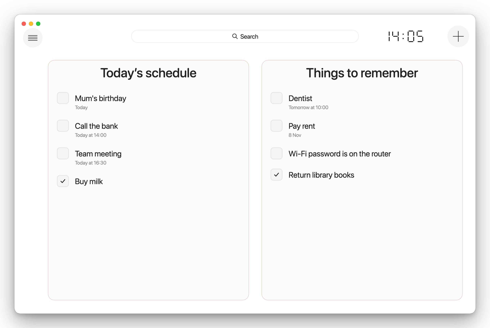
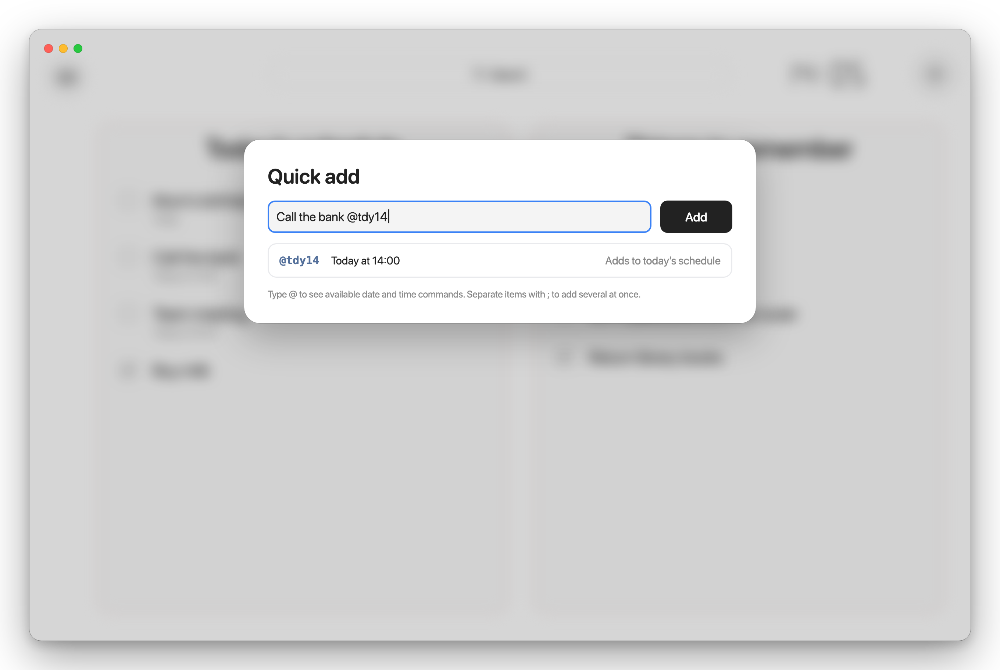
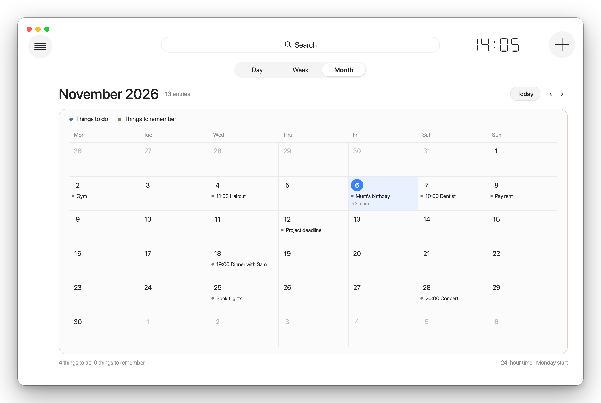
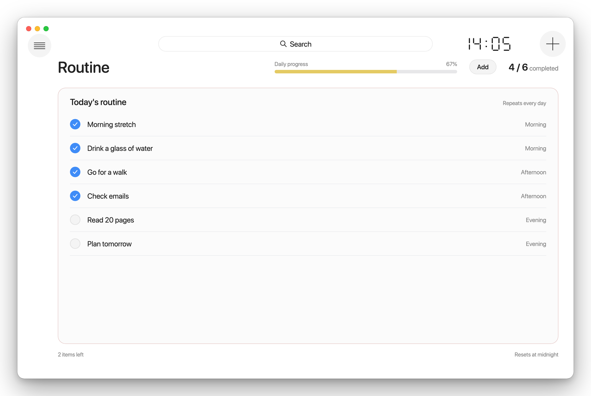
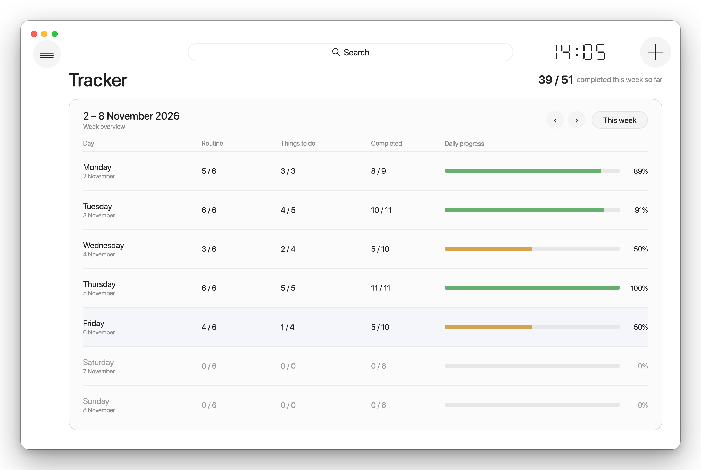
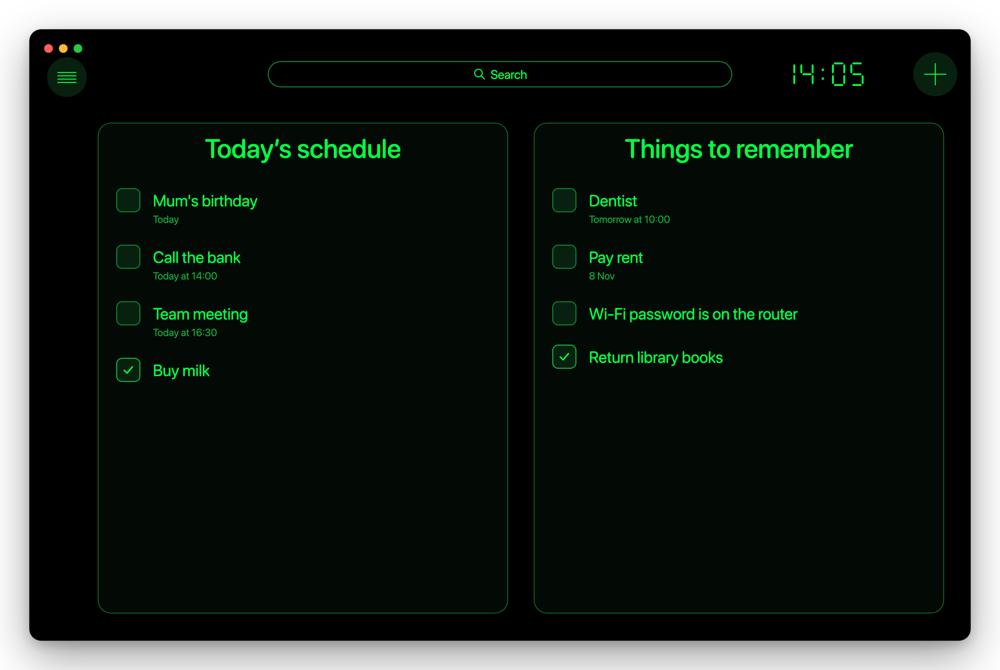

# Yoda

Tired of cluttered to-do apps full of features you never use?  
Want a simple planner that just gets the job done?  
Ready to build a routine and actually see yourself improve?

**You're in the right place.** This is the start of your new chapter.

Yoda is a minimal daily planner with built-in commands, bringing your to-do list, reminders, calendar, daily routine and weekly progress tracker together in one window.

> "1% better every day."
> -- James Clear



[](https://github.com/FireFenix101/Yoda_/releases/latest/download/Yoda.zip)  
Free · Requires macOS 14 or later

## Install

1. Download **Yoda.zip** and open it to unzip.
2. Drag **Yoda** into your **Applications** folder.
3. Open Yoda. macOS will say it can't verify the app. Click **Done**.
4. Open **System Settings › Privacy & Security**, scroll down and click **Open Anyway** next to Yoda.

> [!NOTE]
> You only need to do step 4 once. Yoda isn't registered with Apple, so macOS asks you to confirm it first.

### Updating

Download the latest Yoda.zip and replace the old app in Applications. Your items and routine stay.

## What Yoda does

### 🏠 Home

Two panels side by side, as in the picture at the top. **Today’s schedule** is what you'll do today, and **Things to remember** is what's coming up. Tick items as you go, drag them between panels, or right-click to edit or delete. Anything unfinished is offered again the next morning.

### ➕ Quick add with commands

Press `+` or `Cmd+N`, type what you need, and add an `@` command to set when. Yoda puts it in the right place.



| You type | You get |
|---|---|
| `Gym @tdy` | Today |
| `Call the bank @tdy14` | Today at 14:00 |
| `Dentist @tmr10` | Tomorrow at 10:00 |
| `Mum's birthday @25dec` | 25 December |
| `Concert @28nov20` | 28 November at 20:00 |
| `Wi-Fi password is on the router @rmb` | Things to remember, no date |

Add several at once by separating them with `;`

```
Buy milk @tdy ; Call the bank @tmr10 ; Mum's birthday @25dec
```

### 📅 Calendar

See everything you've planned in Day, Week or Month view. Double-click a day in Month to open it.



### 🔁 Routine

A checklist that repeats every day, sorted into morning, afternoon and evening. It resets at midnight and shows your daily progress.



### 📊 Tracker

Your week at a glance. Each day shows how much of your routine and schedule you finished, coloured from red to green. Click a day to see exactly what you did.



### 🔔 Daily reminder

Click **Alert** in the sidebar, pick a time, and Yoda sends a notification listing what's still unfinished:

> **Today’s schedule**  
> You haven't done "Buy milk" and "Call the bank" yet. Click to see details

### 🎨 Looks your way

Switch between Light, Dark, Auto and **Pro**, a black-and-green terminal style, from the sidebar. Click the clock to switch every time in Yoda between 24-hour and 12-hour.



## Keyboard shortcuts

| Shortcut | Action |
|---|---|
| `Cmd+N` | Quick add |
| `Cmd+F` | Search |
| `Cmd+Z` / `Cmd+Shift+Z` | Undo / redo |

## Privacy

Everything stays on your Mac. No account, no cloud, no tracking.

---

© 2026 George. All rights reserved.
